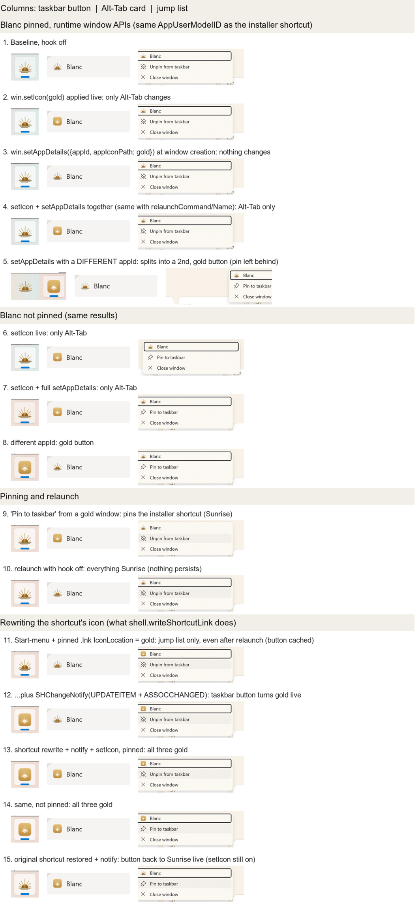
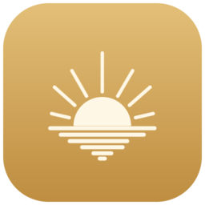

# Can packaged Blanc change its own icon on Windows? (spike, October 19, 2026)

This spike asked whether a selectable app icon such as Sunrise Gold could reach Windows, beyond the macOS Icon Composer version. A design review had warned that Windows might draw the taskbar button from the installer's shortcut, which carries the same AppUserModelID (`me.bnfy.bowser`) that `setWindowsAppUserModelId` gives every window. If so, `BrowserWindow.setIcon` would only change Alt-Tab. This spike only measured. No product code was merged.

## Answer

- **The `BrowserWindow` APIs alone cannot change the taskbar button.**
  - `win.setIcon` changes only the Alt-Tab card. It applies live, and it is lost on relaunch.
  - `win.setAppDetails({ appId, appIconPath })` with Blanc's own app ID changes nothing visible, even with `relaunchCommand` and `relaunchDisplayName` set.
  - Both of these behave the same whether or not Blanc is pinned. With the same AppUserModelID, Windows always takes the button's icon (and the jump list header's) from the installer's shortcut.
- **A different `appId` does give a gold taskbar button, but Windows then treats it as another app.**
  - The window leaves the pinned Blanc button and gets its own button at the end of the taskbar.
  - The pinned Sunrise button is left behind, showing as not running.
  - Rejected: it breaks pinning and would split jump lists and notifications away from the installed shortcut.
- **What works is rewriting the shortcut's own icon, then sending a shell change notification.**
  - The steps: set the Start menu `Blanc.lnk` (and the pinned taskbar `Blanc.lnk`, if there is one) to point at a gold `.ico` file on disk, then call `SHChangeNotify` (`SHCNE_UPDATEITEM` for each `.lnk` path, plus `SHCNE_ASSOCCHANGED`).
  - The taskbar button turns gold live, pinned or not, with Blanc's normal AppUserModelID unchanged. The jump list header turns gold too.
  - Adding `win.setIcon` on every window makes Alt-Tab gold as well, so all three surfaces match.
  - Putting the original shortcut back and notifying again turns the button back to Sunrise live, with no relaunch.
- Without the notification, a rewritten shortcut changes only the jump list header. The taskbar keeps its cached button icon, even across a Blanc relaunch.

So if Windows gets Sunrise Gold, the mechanism is: rewrite the shortcut icon, notify the shell, and call `setIcon` on every window. `setAppDetails` adds nothing.

The test icon was drawn for this spike: a gold rounded tile (#E3BF78 to #BE8D40) with a cream (#FFF7E6) Sunrise mark. It is not final artwork.

## What was run

- **Build.** A throwaway branch added a file-driven hook to `createMainWindowForRuntime`. It read a mode file in userData and applied `setIcon` and/or `setAppDetails` to each window: at creation, and live when the file changed. The branch was built as a signed validation installer (`release-windows-linux.yml`, `mode=validation`, run 39329490999; Authenticode subject Bananify Creative, timestamped). The branch was deleted afterwards.
- **Machine.** Windows 11 25H2, build 26220.9606, in the owner's ARM64 Parallels VM, running x64 Blanc under emulation.
- **Install and launch.** The build was installed over the normal per-user install with `/S`. Blanc was launched from the Start menu shortcut.
- **Automation.** Mouse and keyboard input was sent with `user32` from PowerShell. Taskbar buttons and their AppUserModelIDs were read with UI Automation. Screenshots came from `prlctl capture`.
- **Shortcut cases.** These were done with PowerShell (`WScript.Shell` `IconLocation`, then `SHChangeNotify` through P/Invoke), not from Electron. `Save()` kept each shortcut's `System.AppUserModel.ID` property intact.

| Case | Taskbar button | Alt-Tab | Jump list header |
| --- | --- | --- | --- |
| `setIcon` (pinned or not) | Sunrise | **Gold** | Sunrise |
| `setAppDetails`, same app ID (with or without relaunch command/name) | Sunrise | Sunrise | Sunrise |
| Both | Sunrise | **Gold** | Sunrise |
| `setAppDetails`, different app ID | **Gold**, but a separate second button | Sunrise | Sunrise, offers "Pin to taskbar" |
| "Pin to taskbar" from a window with full `setAppDetails` | Pins the installer shortcut: Sunrise | — | Sunrise |
| Relaunch with the hook off | Sunrise | Sunrise | Sunrise (nothing persists) |
| Shortcut icon rewritten, no notification (even after relaunch) | Sunrise | Sunrise | **Gold** |
| Shortcut icon rewritten + `SHChangeNotify` | **Gold**, live | Sunrise | **Gold** |
| Shortcut rewrite + notify + `setIcon` (pinned or not) | **Gold** | **Gold** | **Gold** |
| Original shortcut restored + notify | Sunrise, live | (`setIcon` still on) | Sunrise |

A silent reinstall of the public 1.38.0 over the rewritten shortcuts left both shortcuts pointing at the gold icon. So the installer does not seem to reset an existing shortcut's icon, though an update through electron-updater was not tested.

## Open questions before any Windows work

- **The notification.** Electron has no `SHChangeNotify`. Rewriting the shortcut is Electron's `shell.writeShortcutLink(path, 'update', { icon, iconIndex: 0 })`. Whether that call alone refreshes the taskbar was not tested here, and the `WScript.Shell` save did not. Blanc would probably need a small native call, which is a new native dependency to review.
- **Which shortcuts.** The installer's Start menu shortcut is easy to find. The pinned copy lives in `%APPDATA%\Microsoft\Internet Explorer\Quick Launch\User Pinned\TaskBar`. Shortcuts users made themselves (desktop and elsewhere) would stay Sunrise.
- **Where the icon lives.** The `.ico` must be a real file, not inside `app.asar`. A fixed path under `resources` (via `extraResources`) keeps the same path across updates. If the file goes missing, Windows draws a blank icon.
- **Updates and uninstall.** Behavior across a real electron-updater update and **Restart Now** was not tested. Uninstalling removes the shortcuts anyway.
- **Coverage.** This is one VM and one Windows build. Windows 10, small taskbar buttons, multiple monitors and real hardware were not checked.

## VM state afterwards

- **Install.** The public signed 1.38.0 installer, checksum-verified against the release's `SHA256SUMS`, was reinstalled, and `Blanc.exe` verifies as validly signed.
- **Shortcuts.** Both shortcuts were restored from backups taken before the shortcut cases, and the shell was notified.
- **Spike files.** The spike's userData files (`icon-spike.txt`, `icon-spike.log`, `spike-gold.ico`) and the backup folder were deleted.
- **Pin position.** Blanc is pinned again, but at the end of the taskbar rather than in its old spot after Edge.
- **Profile.** The spike build ran briefly on the VM's normal Blanc profile, which opened the What's New page in a tab.
